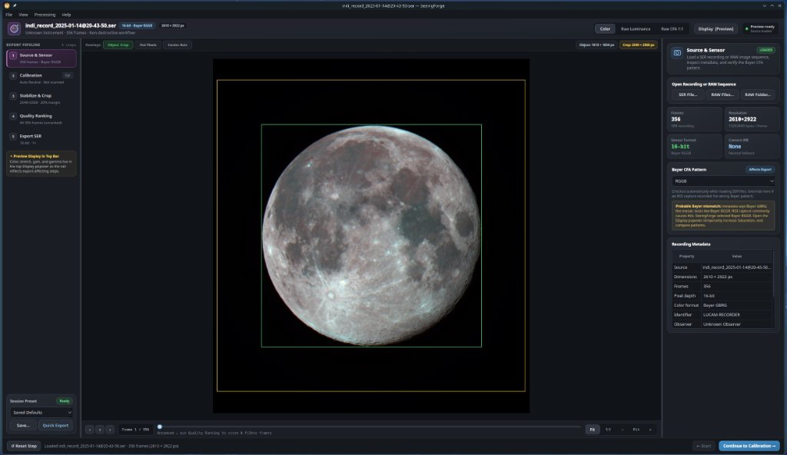

# SeeingForge

SeeingForge is an open-source desktop application for preparing planetary, lunar, and solar SER and uncompressed/RAW AVI recordings (including ZWO SeeStar RAW AVIs) and DSLR RAW image sequences for stacking.



*SeeingForge v0.3.0 preparing a 356-frame 16-bit INDI lunar SER recording (`2610 × 2922 px`), showing automatic ROI Bayer mismatch detection, object and recommended crop overlays, and the 5-step export pipeline workspace.*

It grew out of a personal need for a Linux-native workflow inspired by PIPP (Planetary Imaging PreProcessor). With PIPP apparently no longer actively developed, the author could not find a suitable native Linux replacement for their workflow. SeeingForge is an independent project and is not affiliated with PIPP.

## AI acknowledgment

SeeingForge was built with substantial assistance from OpenAI's Codex AI coding agent, including implementation, interface development, tests, and documentation. The human project creator supplied the requirements, astronomy recordings, workflow decisions, and hands-on testing. This is not presented as solely human-written software; credit reflects that collaboration.

## Platform status

**Early experimental software. Tested on Fedora 44 and Fedora 45.**

The application uses C++20 and Qt 6 and is designed for Linux, Windows, and macOS. Linux is the primary development platform. Windows packages receive automated build and test coverage and limited hands-on testing. macOS packages receive automated build and test coverage but have not yet been tested on physical Mac hardware.

### Imaging test coverage

Hands-on astronomical testing has covered full-disc lunar and full-disc solar SER recordings, DSLR RAW sequences, and ZWO SeeStar RAW AVI recordings (with `.avi.txt` sidecar metadata). Close-up lunar or solar surface recordings have not yet been tested, so detection, stabilization, cropping, and quality selection may need further adjustment for those workflows.

## Features

- Guided 5-step export pipeline (**Source & Sensor**, **Calibration**, **Stabilize & Crop**, **Quality Ranking**, and **Export SER**) with telemetry summary tiles, built-in and custom saved **Session Presets**, and an anchored step footer.
- SER input with 8–16-bit monochrome, Bayer, and RGB/BGR data (including INDI recordings), cross-platform uncompressed/RAW AVI & OpenDML AVI support (8-bit/16-bit raw and 24-bit/32-bit RGB/BGR, including ZWO SeeStar RAW AVIs with `.avi.txt` sidecar metadata and UTC timestamps), plus multi-file or folder import of DSLR RAW sequences through LibRaw (CR2 and other supported camera formats), accessible via the File menu, empty-state quick-start hub, or drag-and-drop.
- Automatic ROI Bayer CFA pattern mismatch detection (and automatic Bayer mosaic detection with missing-sidecar warnings when an uncompressed AVI lacks its `.avi.txt` metadata file) in **Source & Sensor**, with manual pattern override for preview and export.
- Top-bar **Display [Preview]** popover separating preview-only adjustments (debayer method, auto white balance, red/blue balance, saturation, hue shift, preview gain/gamma, and auto-stretch) from export-affecting steps so display tuning is available at every stage.
- Viewport modes for **Color**, **Raw Luminance**, and 1:1 **Raw CFA** mosaic inspection; toggleable **Object & Crop**, **Hot Pixels**, and **Center Axis** overlays; mouse-wheel zoom, click-drag panning when zoomed, frame playback (`Space`), and keyboard frame stepping (`←`/`→`).
- Persistent hot-pixel detection and overlay inspection across sampled frames.
- Bayer-aware threshold object detection, 90°/180°/270° orientation and horizontal/vertical flips, selectable crop margins, and ÷4-aligned export canvas dimensions.
- Multi-threaded **Quality Ranking** with progress/cancellation, clickable quality curve with visible keep-cutoff line, `All` / `Kept` / `Clipped` / `Obscured` filter chips, single-click frame inspection, overexposed and cloud/obscured-frame rejection (`targetCoverage`), and deterministic unclamped ranking (keep best 10%, 25%, 50%, 75%, or 100%).
- Capture-order or quality-score inspection and export ordering, using the best-ranked eligible frame as the reference for automatic crop sizing and neutral balance when quality analysis has been run.
- High-speed multi-threaded RAW sequence validation, hot-pixel scanning, and batched parallel SER export with cached per-frame object detection, post-crop LUT intensity/channel scaling, and preloaded SER frame timestamps.
- Linear 16-bit Bayer SER export from RAW sequences with sensor black-level subtraction and white-level normalization, optional camera white balance or highlight-safe automatic neutral balance, fixed 2×–16× or automatic 90%-peak intensity gain, and full-resolution or 2×2 binned monochrome export.
- Export progress and cancellation without committing a partial SER file, plus post-export quick actions (**Open Folder**, **Inspect Output**, and **Copy Path**).

Exports go beside the source in a `seeingforge_yyyymmdd_hhmm` folder; repeated exports within one minute receive a numeric suffix. The original recording is not modified.

## Working with ZWO SeeStar & RAW AVI recordings

Use **File > Open AVI Recording…**, **File > Open SER File…**, the Quick-Start Hub, or drag and drop an `.avi` file (optionally alongside its `.avi.txt` metadata file) onto the window. SeeingForge reads uncompressed 8-bit/16-bit raw and 24-bit/32-bit RGB/BGR AVIs (including OpenDML AVIs larger than 2 GB) natively in C++ across Linux, Windows, and macOS without external video codecs.

For raw single-plane AVIs (such as ZWO SeeStar `RAW8` recordings), SeeingForge looks for the accompanying `.avi.txt` (or `<name>.txt`) sidecar file to read the Bayer CFA pattern (e.g., `Bayer = GR` → `GRBG`), camera/sensor metadata, and UTC `DATE-OBS` timestamp for per-frame SER timestamp preservation. If the `.txt` file is missing, SeeingForge warns the user, inspects the pixel mosaic to suggest the Bayer pattern if present, and allows manual pattern override in **Source & Sensor**. In **Quality Ranking**, the **Reject obscured / dim (min signal)** filter helps exclude passing clouds or haze drops automatically alongside overexposed-frame rejection.

## Working with DSLR RAW sequences

Use **File > Open RAW Image Sequence…** to select individual frames, **File > Open RAW Folder…** to load every supported RAW file in one folder, or drag and drop RAW files or a folder directly onto the window. SeeingForge sorts the selected frames into natural filename order and shows a cancellable loading window while validating metadata in parallel.

In **Calibration**, choose whether the exported SER should preserve linear sensor values, apply camera white balance recorded in RAW metadata, or automatically neutralize the target. Preserving sensor values is intended for workflows that perform neutralization and color calibration after stacking. Automatic neutral balance measures the visible target and reduces the stronger Bayer channels to match the weakest one, avoiding highlight clipping while producing a more neutral starting point for software such as AutoStakkert.

The crop selected in **Stabilize & Crop** remains visible in **Quality Ranking** and **Export SER**. When **Quality Ranking** has been run, automatic crop sizing and automatic neutral balance reference the best-ranked eligible frame rather than only whichever frame happens to be displayed. Before export, the intensity tiles report the measured target peak and estimated output peak; gain is applied via lookup table after centering and cropping, with values beyond the source bit depth clipped.

## Current limitations

- Controls inside the **Display [Preview]** popover and viewport overlays affect only the preview, not export.
- A RAW sequence must use one camera, active image size, and 2×2 RGB Bayer pattern. X-Trans, Foveon, and already-demosaiced RAW data are not yet supported.
- Hot-pixel correction is not implemented; detection is available.
- Quality scores are experimental and relative to the current recording. Noise and exposure changes can affect ranking; inspect the results.
- Centering uses the largest detected object's bounding box, not subpixel registration. A frame with no detection falls back to the source center. Bayer shifts use even-pixel offsets; uncovered edges are black.
- Full-resolution Bayer monochrome supports RGGB, GRBG, GBRG, and BGGR. Complementary-colour Bayer formats require binning for monochrome export.
- Compressed AVI video codecs (such as MJPEG, H.264, or FFV1) are not supported; AVI input is intended for uncompressed planetary/solar/lunar recordings (`DIB` / `BI_RGB`, `RAW`, `Y800`, `Y16`).
- SER is currently the only export format. Additional formats are intended for future development.

## Future updates

Planned future work includes additional output format options, hot-pixel correction, and support for additional telescope/camera capture metadata variants.

## Build

Ready-to-run packages for Linux, Windows, and macOS are available from the
[GitHub Releases](https://github.com/csmisi/SeeingForge/releases) page. The
Linux download is an AppImage: make it executable, then launch it. Windows and
macOS packages are currently unsigned test builds and may show an operating
system security warning on first launch.

### Build from source

Requires a C++20 compiler, CMake 3.25+, Ninja, LibRaw, and Qt 6.6+ with Core, Gui, Widgets, Concurrent, and Test. On Fedora 44 / 45:

```bash
sudo dnf install gcc-c++ cmake ninja-build qt6-qtbase-devel LibRaw-devel
git clone https://github.com/csmisi/SeeingForge.git
cd SeeingForge
```

```bash
cmake -S . -B build -G Ninja -DCMAKE_BUILD_TYPE=Debug
cmake --build build
ctest --test-dir build --output-on-failure
./build/SeeingForge
```

On Debian or Ubuntu, install `libraw-dev`; on macOS, install `libraw` with Homebrew. The intended Windows build route is Qt Creator with a matching Qt 6/MSVC desktop kit, CMake, and LibRaw (for example through vcpkg). macOS still requires hands-on runtime testing.

## Feature requests and contributions

Development is driven by **maintainer-approved feature requests**. Open a Feature request issue explaining your workflow, desired behavior, and why it would help. Requests are reviewed individually and do not guarantee implementation or a timeline.

Unsolicited implementation pull requests are not currently accepted. Please discuss a feature request and obtain maintainer agreement before preparing code for inclusion. Anyone can inspect, download, build, and fork the code under its license; public visibility does not grant write access to the official repository. See [CONTRIBUTING.md](CONTRIBUTING.md).

## License

Copyright (C) 2026 SeeingForge contributors.

This project is licensed under the GNU General Public License, version 3 or any
later version (GPL-3.0-or-later). See [LICENSE](LICENSE). Dependencies retain their respective licenses.
