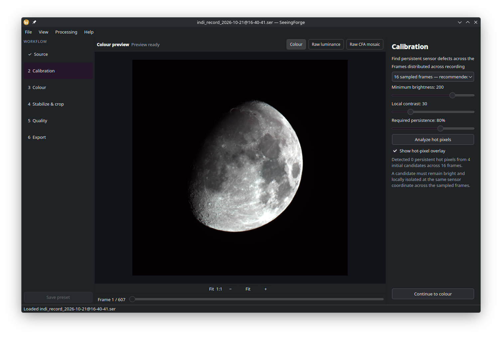

# SeeingForge

SeeingForge is an open-source desktop application for preparing planetary and lunar SER recordings and DSLR RAW image sequences for stacking.



*SeeingForge running on Fedora 44 with a lunar recording and hot-pixel detection controls.*

It grew out of a personal need for a Linux-native workflow inspired by PIPP (Planetary Imaging PreProcessor). With PIPP apparently no longer actively developed, the author could not find a suitable native Linux replacement for their workflow. SeeingForge is an independent project and is not affiliated with PIPP.

## AI acknowledgment

SeeingForge was built with substantial assistance from OpenAI's Codex AI coding agent, including implementation, interface development, tests, and documentation. The human project creator supplied the requirements, astronomy recordings, workflow decisions, and hands-on testing. This is not presented as solely human-written software; credit reflects that collaboration.

## Platform status

**Early experimental software. Only Fedora 44 has been tested.**

The application uses C++20 and Qt 6 and is designed for Linux, Windows, and macOS. Linux is the primary development platform. Windows packages receive automated build and test coverage and limited hands-on testing. macOS packages receive automated build and test coverage but have not yet been tested on physical Mac hardware.

## Features

- Guided Source, Calibration, Color, Stabilize & crop, Quality, and Export workflow.
- SER input with 8–16-bit monochrome, Bayer, and RGB/BGR data, including INDI recordings.
- Multi-file or folder import of DSLR RAW sequences through LibRaw, including CR2 and other supported camera formats.
- Frame navigation, color and raw previews, fit, actual size, and zoom controls.
- Preview white balance, saturation, hue, Bayer pattern selection, and display stretching.
- Persistent hot-pixel detection and inspection overlay.
- Threshold-based object detection and selectable crop margins.
- Quality analysis with progress and cancellation; keep the best 10%, 25%, 50%, 75%, or 100%.
- Capture-order or quality-score inspection and export ordering.
- SER export with per-frame object centering, fixed crop dimensions, source bit depth, and available frame timestamps.
- Linear 16-bit Bayer SER export from RAW sequences, with sensor black-level subtraction and white-level normalization.
- Optional camera white balance for RAW-to-SER export, plus automatic highlight-safe neutral balance for Bayer SER and RAW sources.
- Export intensity controls with measured target peak reporting, fixed 2×–16× gains, and automatic target normalization for stacking software.
- Full-resolution monochrome export with optional 2×2 binning.
- Export progress and cancellation without committing a partial SER file.

Exports go beside the source in a `seeingforge_yyyymmdd_hhmm` folder; repeated exports within one minute receive a numeric suffix. The original recording is not modified.

## Working with DSLR RAW sequences

Use **File > Open RAW image files…** to select individual frames, or **File > Open RAW image folder…** to load every supported RAW file in one folder. File selection is useful when a folder contains unrelated exposures; folder selection is the quickest choice for a dedicated capture sequence. SeeingForge sorts the selected frames into natural filename order and shows a cancellable loading window while it reads their metadata.

In **Calibration**, choose whether the exported SER should preserve linear sensor values, apply camera white balance recorded in RAW metadata, or automatically neutralize the target. Preserving sensor values is intended for workflows that perform neutralization and color calibration after stacking. Automatic neutral balance measures the visible target and reduces the stronger Bayer channels to match the weakest one, avoiding highlight clipping while producing a more neutral starting point for software such as AutoStakkert.

The crop selected in **Stabilize & crop** remains visible in **Quality** and **Export**. Before export, the intensity panel reports the measured target peak and estimated output peak. Keep the original values for a strictly linear conversion, select a fixed gain, or use automatic normalization when downstream stacking software has difficulty detecting a dim target. Gain is applied uniformly after centering and cropping; values beyond the 16-bit range are clipped.

## Current limitations

- Color controls and overlays affect only the preview, not export.
- A RAW sequence must use one camera, active image size, and 2×2 RGB Bayer pattern. X-Trans, Foveon, and already-demosaiced RAW data are not yet supported.
- Hot-pixel correction is not implemented; detection is available.
- Quality scores are experimental and relative to the current recording. Noise and exposure changes can affect ranking; inspect the results.
- Centering uses the largest detected object's bounding box, not subpixel registration. A frame with no detection falls back to the source center. Bayer shifts use even-pixel offsets; uncovered edges are black.
- Full-resolution Bayer monochrome supports RGGB, GRBG, GBRG, and BGGR. Complementary-colour Bayer formats require binning for monochrome export.
- SER is currently the only export format. Additional formats are intended for future development.

## Build

Ready-to-run packages for Linux, Windows, and macOS are available from the
[GitHub Releases](https://github.com/csmisi/SeeingForge/releases) page. The
Linux download is an AppImage: make it executable, then launch it. Windows and
macOS packages are currently unsigned test builds and may show an operating
system security warning on first launch.

### Build from source

Requires a C++20 compiler, CMake 3.25+, Ninja, LibRaw, and Qt 6.6+ with Core, Gui, Widgets, Concurrent, and Test. On Fedora 44:

```bash
sudo dnf install gcc-c++ cmake ninja-build qt6-qtbase-devel LibRaw-devel
git clone https://github.com/csmisi/SeeingForge.git
cd SeeingForge
```

```bash
cmake -S . -B build -G Ninja -DCMAKE_BUILD_TYPE=Debug
cmake --build build
ctest --test-dir build --output-on-failure
./build/seeingforge
```

On Debian or Ubuntu, install `libraw-dev`; on macOS, install `libraw` with Homebrew. The intended Windows build route is Qt Creator with a matching Qt 6/MSVC desktop kit, CMake, and LibRaw (for example through vcpkg). macOS still requires hands-on runtime testing.

## Feature requests and contributions

Development is driven by **maintainer-approved feature requests**. Open a Feature request issue explaining your workflow, desired behavior, and why it would help. Requests are reviewed individually and do not guarantee implementation or a timeline.

Unsolicited implementation pull requests are not currently accepted. Please discuss a feature request and obtain maintainer agreement before preparing code for inclusion. Anyone can inspect, download, build, and fork the code under its license; public visibility does not grant write access to the official repository. See [CONTRIBUTING.md](CONTRIBUTING.md).

## License

Copyright (C) 2026 SeeingForge contributors.

This project is licensed under the GNU General Public License, version 3 or any
later version (GPL-3.0-or-later). See [LICENSE](LICENSE). Dependencies retain their respective licenses.
